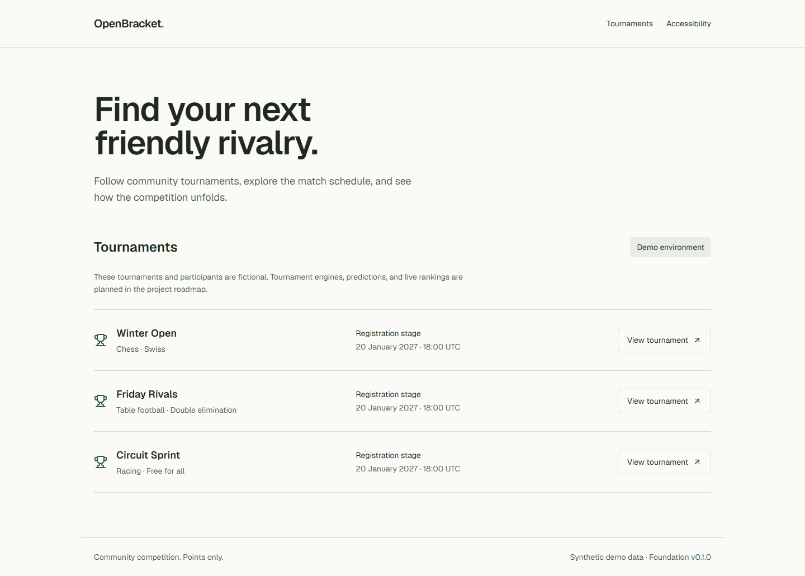

# OpenBracket

[](https://github.com/MCK-D/openbracket/actions/workflows/ci.yml)

A community tournament and prediction platform foundation. Built with the [T3 Stack](https://create.t3.gg/en/introduction): Next.js App Router, TypeScript, Prisma, PostgreSQL, tRPC, Auth.js, Tailwind CSS and shadcn/ui. A separate native Android skeleton reads the public API.

This is a working foundation, not the completed product. Tournament engines, registrations, predictions, Pick'em, source imports, real-time rankings and notifications remain in the [GitHub roadmap](https://github.com/users/MCK-D/projects/2). All demonstration identities are synthetic. No money or valuable prizes are involved.

## Start in one command

Prerequisites: Git, Node.js 24, Docker with Compose, and port 3000 available. Clone this repository and run:

```sh
npm run setup
```

Open <http://localhost:3000>. Setup generates a local secret, builds the image, starts PostgreSQL on port 55432, applies migrations and seeds three fictional tournaments. The first build needs network access. Existing `.env` files are preserved. See the [developer guide](docs/development.md) for active development, diagnostics and the 15-minute newcomer target.

```sh
docker compose exec app npm test        # Offline web and server tests
docker compose exec app npm run demo    # Play one synthetic match
docker compose down                     # Stop; keep data
```

For local development: `npm ci`, `docker compose up db --detach --wait`, `npm run db:migrate`, `npm run db:seed`, then `npm run dev`. Create `.env` from `.env.example` with a random auth secret first if setup has not run.

## Current app

Browse public tournaments and open an accessible match schedule. The database-backed JSON API is available at `/api/v1/tournaments`; `/api/health` verifies readiness. The backend has an administrator-authorized tournament creation procedure with atomic auditing. Demo authentication exposes only one synthetic spectator, never an administrator.

<!-- The screenshot below is captured from the actual seeded app, not a mockup. -->



## Validation

```sh
npm run check
npm run format:check
npm test
npm run build
npx playwright install chromium
npm run test:e2e
```

Browser tests require the seeded database and a production build. For native tests and an APK, run `cd mobile` followed by `./gradlew testDebugUnitTest lintDebug assembleDebug` (`gradlew.bat` on Windows). See the [Android guide](docs/mobile.md) for emulator/device setup. CI runs all suites and uploads an installable debug APK for every successful PR/branch build.

## Environments and contribution

Feature PRs target protected `develop` for staging. Release PRs promote `develop` into protected `main` for production. Both require a linked issue, Conventional Commits, passing CI and an independent approving review. See [CONTRIBUTING.md](CONTRIBUTING.md).

Staging and production are configured as two Vercel Hobby projects and two independent Neon Free PostgreSQL projects. `vercel.json` disables automatic Git deployments so GitHub CI controls release. **Staging deployment is enabled. Secret forwarding, database preparation and the Prisma runtime fix are in place. A follow-up corrects bundle validation for Vercel's file maps; no live deployment is verified yet. Production remains disabled until staging is verified.** See [deployment instructions](docs/deployment.md) for project IDs and reserved domains.

## Documentation and planning

- [Documentation index](docs/README.md), [architecture and API](docs/architecture.md), [connector tutorial](docs/connectors.md)
- [User guide](docs/users.md), [accessibility evidence](docs/accessibility.md), [requirements coverage](docs/requirements.md)
- [Kanban and roadmap](https://github.com/users/MCK-D/projects/2), [issues](https://github.com/MCK-D/openbracket/issues)

The board organizes epics with native sub-issues, user stories, acceptance criteria, labels, milestones and status. All issues are intentionally unassigned until contributors are selected.

## AI assistance

OpenAI Codex assisted with the initial scaffold, implementation, tests, workflows, backlog and documentation. The team remains responsible for reviewing, understanding, testing and explaining every delivered part. Generated work follows the same PR and review rules as other contributions. No generated artwork or third-party game branding is used. Geist fonts, Lucide icons and dependencies retain their respective licenses; project source is [MIT licensed](LICENSE).
