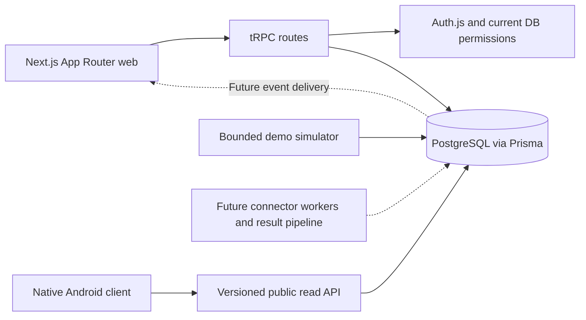

# Architecture and API



Web and backend are one deployable Next.js app. Server implementation lives under `src/server`, and transport handlers under `src/app/api`. The separate native client consumes a versioned JSON read API. tRPC supplies end-to-end web types. PostgreSQL owns persistence; Prisma owns schema and migrations. No in-memory fallback hides database outages.

## Data model implemented

| Entity                                | Fields and meaning                                                                                                            |
| ------------------------------------- | ----------------------------------------------------------------------------------------------------------------------------- |
| User                                  | cuid ID, name, unique lower-cased email, role (default SPECTATOR), optional scrypt `passwordHash`, `sessionVersion`           |
| Account / Session / VerificationToken | Standard Auth.js adapter schema; credentials sign-in uses 8-hour JWT sessions                                                 |
| Tournament                            | ID, name, game label, format enum, status, visibility, start time, optional source URL and connector/external IDs, timestamps |
| Match                                 | Tournament FK, round, synthetic participant labels, scores, start/completion times, optimistic version counter                |
| AuditLog                              | Actor FK, action, affected entity ID, timestamp                                                                               |

Public lists filter visibility and cap results at 100. Connector/external ID pairs are unique. Audit writes and tournament creation share a transaction.

### Identity and sessions

- **Roles.** `ADMIN` runs tournaments and roles; `PLAYER` enters tournaments and predicts; `SPECTATOR` follows and predicts (`canPredict`). Sign-up offers only PLAYER or SPECTATOR. ADMIN is granted by an administrator (`account.setRole`) or, for the first one, by the operator script `npm run user:grant-admin -- <email>` run with the environment's database URL. Emails are not verified, so the script asks for that account's password before granting: an account squatting the expected email cannot be promoted by mistake. The last administrator cannot be demoted.
- **Passwords.** scrypt (N=2^15, r=8, p=1, 16-byte random salt, NFKC-normalised input), 12 to 128 characters, compared in constant time. Sign-in spends the same hashing work for unknown or password-less accounts. Registration does reveal that an email is taken (409 CONFLICT); preventing that needs email verification, so until then #8 rate-limits registration. Hashes never leave the server, and the browser tRPC logger runs only in development so inputs such as passwords are never printed in production.
- **Sessions.** Each JWT records its sign-in time; on every session read the `jwt` callback rejects tokens older than 8 hours (Auth.js slides the cookie expiry on each read, so the sign-in time is the real limit), tokens of deleted users, tokens whose `sessionVersion` differs from the database, and demo tokens once `DEMO_AUTH_ENABLED` is off. The role always comes from PostgreSQL. Incrementing `sessionVersion` revokes every session of that user; it happens on **Sign out everywhere**, a password change and a role change. Administrator procedures (`adminProcedure`) also reload the role before acting.
- **CSRF.** Auth.js protects its own forms with a double-submit token. Every tRPC mutation refuses a request whose `Origin` differs from the request host (`x-forwarded-host` on Vercel). Requests without `Origin` come from non-browser clients, which carry no ambient cookies of another site.
- **Abuse bounds.** A tRPC request carries at most 10 batched calls, so one request cannot trigger hundreds of password hashes. Unexpected errors return a generic message in production. Per-IP and per-account rate limits are #8.
- **Demo.** With `DEMO_AUTH_ENABLED=true` the `demo` provider additionally signs in the fixed synthetic `demo-spectator`. That shared identity cannot revoke sessions or change a password. No administrator account is seeded.

The schema deliberately leaves full games/stat definitions, stages, rounds/games, teams, memberships, registrations, predictions, questions, answers, ledger entries, rankings, private groups, source cache and event outbox for their epics. Matches currently use labels rather than player/team relations. These are explicit extension points, not finished domain modeling.

## API reference

| Interface                 | Input                              | Output / authorization                                                                                                   |
| ------------------------- | ---------------------------------- | ------------------------------------------------------------------------------------------------------------------------ |
| `GET /api/health`         | None                               | 200 `{status:"ok",service:"openbracket",version:"0.1.0",revision:"..."}` if DB responds, otherwise safe 503              |
| `GET /api/v1/tournaments` | None                               | 200 `{data:[{id,name,game,format,status,startsAt,sourceUrl}]}`; only public records, 100 maximum; safe 503 on DB failure |
| `tournament.list`         | None                               | Same bounded public selection, transported through `/api/trpc/tournament.list`                                           |
| `tournament.create`       | `{name,game,format,startsAt:Date}` | Current ADMIN role required; future start time, validated lengths; atomic tournament and audit record                    |
| `/api/auth/*`             | Auth.js protocol                   | `password` provider (email + password); `demo` spectator only when enabled; CSRF-protected Auth.js forms                 |
| `account.register`        | `{name,email,password,role}`       | Public; role PLAYER or SPECTATOR only; 409 CONFLICT on a used email; audited                                             |
| `account.me`              | None                               | Signed-in user's id, name, email, role                                                                                   |
| `account.revokeSessions`  | None                               | Signed in; ends every session of the user; audited                                                                       |
| `account.changePassword`  | `{currentPassword,newPassword}`    | Signed in; current password required; ends every session; audited                                                        |
| `account.setRole`         | `{userId,role}`                    | Current ADMIN; refuses removing the last administrator; ends the target's sessions; audited                              |

```sh
curl http://localhost:3000/api/v1/tournaments
curl http://localhost:3000/api/health
```

Web client example: `api.tournament.list.useQuery()` using `src/trpc/react.tsx`. Server components may use the generated RSC caller in `src/trpc/server.ts`. Native clients must not depend on tRPC's transport encoding.

## Future result flow

Validated local or connector results must enter one idempotent result service, update brackets and qualifications, resolve predictions/Pick'em, append an auditable points ledger, and publish one versioned event after transaction commit. Corrections must recalculate descendants and affected points without duplicate awards. A transactional outbox and SSE are the proposed approach; neither is implemented yet. Prediction mutations must enforce server time in the database transaction, not only use the existing pure deadline helper.

See [ADR 0002](adr/0002-vercel-neon.md) for hosting and [ADR 0001](adr/0001-foundation.md), [connectors](connectors.md), and the [requirements map](requirements.md).
