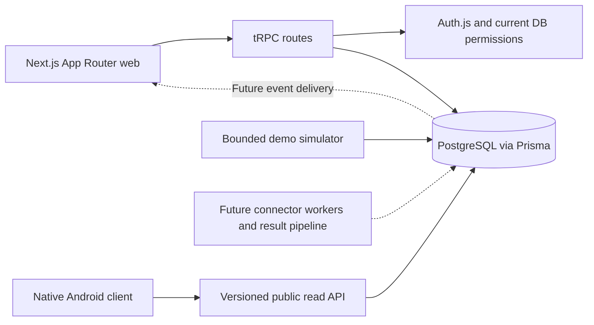

# Architecture and API



Web and backend are one deployable Next.js app. Server implementation lives under `src/server`, and transport handlers under `src/app/api`. The separate native client consumes a versioned JSON read API. tRPC supplies end-to-end web types. PostgreSQL owns persistence; Prisma owns schema and migrations. No in-memory fallback hides database outages.

## Data model implemented

| Entity                                | Fields and meaning                                                                                                            |
| ------------------------------------- | ----------------------------------------------------------------------------------------------------------------------------- |
| User                                  | cuid ID, synthetic name/email, role; default SPECTATOR                                                                        |
| Account / Session / VerificationToken | Standard Auth.js adapter schema; demo credentials currently use JWT sessions                                                  |
| Tournament                            | ID, name, game label, format enum, status, visibility, start time, optional source URL and connector/external IDs, timestamps |
| Match                                 | Tournament FK, round, synthetic participant labels, scores, start/completion times, optimistic version counter                |
| AuditLog                              | Actor FK, action, affected entity ID, timestamp                                                                               |

Public lists filter visibility and cap results at 100. Connector/external ID pairs are unique. Audit writes and tournament creation share a transaction. Demo spectator sessions carry only the subject ID; privileged mutations reload the user role from PostgreSQL. No administrator account or generic password login is seeded. The credentials provider is opt-in and accepts one fixed synthetic alias.

The schema deliberately leaves full games/stat definitions, stages, rounds/games, teams, memberships, registrations, predictions, questions, answers, ledger entries, rankings, private groups, source cache and event outbox for their epics. Matches currently use labels rather than player/team relations. These are explicit extension points, not finished domain modeling.

## API reference

| Interface                 | Input                              | Output / authorization                                                                                                   |
| ------------------------- | ---------------------------------- | ------------------------------------------------------------------------------------------------------------------------ |
| `GET /api/health`         | None                               | 200 `{status:"ok",service:"openbracket",version:"0.1.0",revision:"..."}` if DB responds, otherwise safe 503              |
| `GET /api/v1/tournaments` | None                               | 200 `{data:[{id,name,game,format,status,startsAt,sourceUrl}]}`; only public records, 100 maximum; safe 503 on DB failure |
| `tournament.list`         | None                               | Same bounded public selection, transported through `/api/trpc/tournament.list`                                           |
| `tournament.create`       | `{name,game,format,startsAt:Date}` | Current ADMIN role required; future start time, validated lengths; atomic tournament and audit record                    |
| `/api/auth/*`             | Auth.js protocol                   | Synthetic spectator login only when explicitly enabled; CSRF-protected Auth.js forms                                     |

```sh
curl http://localhost:3000/api/v1/tournaments
curl http://localhost:3000/api/health
```

Web client example: `api.tournament.list.useQuery()` using `src/trpc/react.tsx`. Server components may use the generated RSC caller in `src/trpc/server.ts`. Native clients must not depend on tRPC's transport encoding.

## Future result flow

Validated local or connector results must enter one idempotent result service, update brackets and qualifications, resolve predictions/Pick'em, append an auditable points ledger, and publish one versioned event after transaction commit. Corrections must recalculate descendants and affected points without duplicate awards. A transactional outbox and SSE are the proposed approach; neither is implemented yet. Prediction mutations must enforce server time in the database transaction, not only use the existing pure deadline helper.

See [ADR 0001](adr/0001-foundation.md), [connectors](connectors.md), and the [requirements map](requirements.md).
